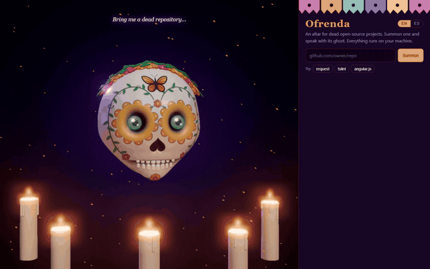
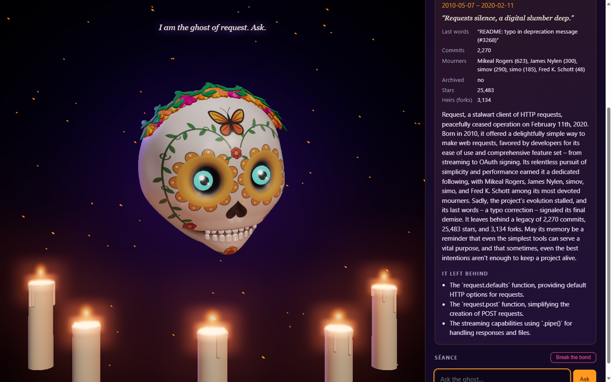
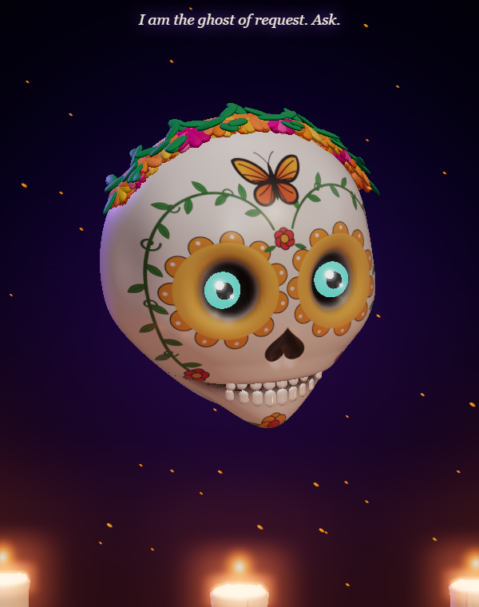

# Ofrenda

**An altar for dead open-source projects.** Paste the URL of an abandoned GitHub repo and Ofrenda
reads its git history, builds a Día de Muertos *ofrenda* for it and summons its ghost: a floating
3D sugar skull you can question. Everything AI runs on your own machine with open-weight models.

Built for the [DEV Hacktoberfest Open-Source AI Challenge, week 4: *Ghost in the Machine*](https://dev.to/challenges/hacktoberfest-week4-2026-10-26).



The full demo, with a second question and breaking the bond, is in [docs/media/demo.mp4](docs/media/demo.mp4).

| The ofrenda | The oracle |
| --- | --- |
|  |  |

## What it does

- **The ofrenda**: born (first commit), died (last commit), last words (last commit message),
  most devoted mourners, commit count and, if GitHub answers, stars, heirs (forks) and whether
  it was archived. Gemma writes its epitaph, its obituary and three things it left behind.
- **The séance**: ask the ghost anything. It answers in the first person, grounded in the
  repo's README and docs (retrieval with EmbeddingGemma), and shows which files it drew from.
  When its writings say nothing, it says so instead of inventing.
- **The oracle**: a sugar skull sculpted and hand-painted in code (no 3D assets): marigold crown,
  monarch butterfly, vines, glowing eyes that blink, and a jaw that moves with every streamed word.
- **Still breathing?** Repos with recent commits get a playful "still breathes" ofrenda instead.
- **English or Spanish.** Switch with the EN/ES toggle: the page, the ofrenda and the ghost change language.
- **Break the bond** to dismiss the ghost and summon another.

## Why local and open

Open-source code never fully dies: its history and writings stay readable by anyone. Ofrenda
keeps it that way: the repo and your questions never leave your machine. The only network
traffic is the `git clone` and one optional call to the public GitHub API.

## Requirements

- Python 3.12 and [uv](https://docs.astral.sh/uv/)
- git
- [Ollama](https://ollama.com) with the two Gemma models:

```bash
ollama pull gemma3:4b
ollama pull embeddinggemma
```

A GPU with 8 GB of VRAM is enough. To use another model, set `OFRENDA_MODEL`
(for example `gemma3:12b` on a bigger GPU) or `OFRENDA_EMBED_MODEL`.

## Run

```bash
uv run python -m ofrenda
```

Then open http://localhost:8666 and summon a repo, or try one of the examples: `request/request`,
`palantir/tslint`, `angular/angular.js`.

## Tests

```bash
uv run pytest
```

## How it works

1. `git clone --filter=blob:none --no-checkout`: full history, no file contents until needed.
   Clones time out after 3 minutes and never open a credential prompt.
2. One `git log` pass gives the facts; README and Markdown docs are read with `git show`.
3. The docs are split into 800-character chunks and embedded with `embeddinggemma`.
4. Gemma 3 (4B) writes the epitaph as JSON (Ollama structured outputs) and answers the séance,
   streamed as newline-delimited JSON to the browser, where each token moves the skull's jaw.
5. The skull is one sculpted mesh (displaced sphere) cut along the mouth into skull and jaw, with
   the tattoos drawn on a canvas and projected onto the face, plus bloom post-processing.

```
ofrenda/
  repo.py      git archaeology: URL parsing, clone, facts, GitHub API
  rag.py       docs reading, chunking, EmbeddingGemma search
  llm.py       Ollama client (check, embed, JSON chat, streaming chat)
  prompts.py   epitaph and oracle prompts (English and Spanish)
  app.py       FastAPI app: /api/summon and /api/ask stream NDJSON
static/
  oracle.js    the 3D sugar skull (three.js)
  app.js       page logic, translations, séance
tests/         pytest suite (a tiny git repo is built on the fly)
```

## Troubleshooting

- **Everything is slow**: check that Ollama uses your GPU (`ollama ps` should say `100% GPU`).
  If it says CPU, reinstall Ollama; an interrupted update can leave its CUDA library missing.
- **"Missing model(s)"**: run the `ollama pull` command the page shows.
- **Small models invent things**: the 4B model sometimes names libraries or facts that are not in
  the repo, more often in Spanish. A larger Gemma (`OFRENDA_MODEL=gemma3:12b`) does better.

## Built during the challenge

Written from scratch on 31 October – 1 November 2026, inside the challenge window.
Any commit after the deadline (1 November 2026, 06:59 UTC) will be listed here.

## Credits

- [three.js](https://threejs.org) (MIT), vendored in `static/vendor/` with its own licence file.
- [FastAPI](https://fastapi.tiangolo.com), [httpx](https://www.python-httpx.org), [NumPy](https://numpy.org).
- Gemma 3 and EmbeddingGemma by Google DeepMind, under the Gemma terms of use, run with Ollama.

## Licence

Copyright (C) 2026 Jorge Camacho Mejías

Ofrenda is free software: you can redistribute it and/or modify it under the terms of the
[GNU Affero General Public License](LICENSE) as published by the Free Software Foundation, either
version 3 of the License, or (at your option) any later version. If you run a modified version
as a network service, you must offer its source code to its users.

It is distributed in the hope that it will be useful, but WITHOUT ANY WARRANTY; without even the
implied warranty of MERCHANTABILITY or FITNESS FOR A PARTICULAR PURPOSE. See the licence for details.
